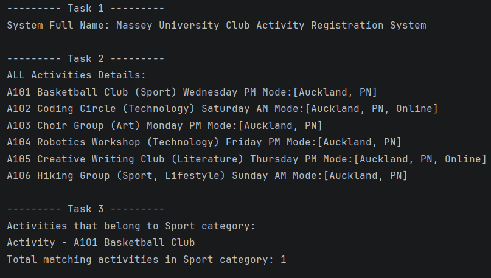
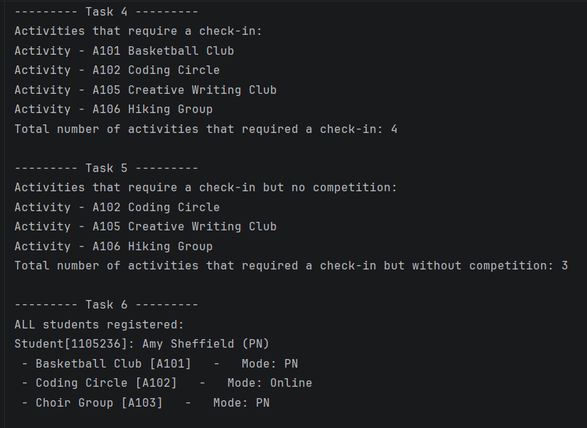
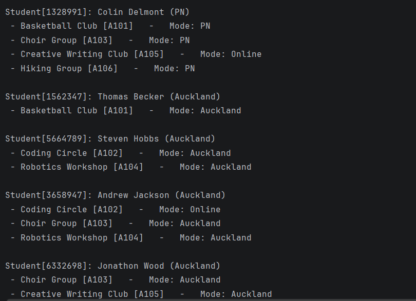
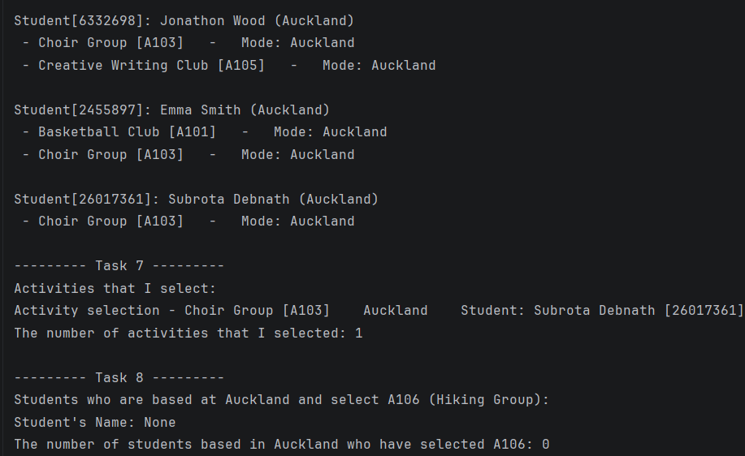

# Massey University Club Activity Registration System


A Java console application designed to simulate a university club activity registration workflow. Built using Object-Oriented Programming (OOP) principles, encapsulation, and dynamic collection management (`ArrayList`).

## 🚀 Features & Capabilities
- **Activity Management:** Stores and categorizes university club activities with time slots, check-in requirements, competition status, and delivery modes (`Auckland`, `PN`, `Online`).
- **Rule-Based Random Registration:** Automatically enrolls students into 1 to 4 unique activities based on campus eligibility (`Auckland` or `Palmerston North`) and online availability.
- **Automated Reporting:** Generates structured console outputs across 8 core tasks, filtering activities by category, check-in/competition criteria, and student enrollment queries.

## 📂 Project Structure
- `MasseyRegistrationSystem.java` — Main driver class containing dataset initialization, randomized registration logic, and task reporting (Tasks 1–8).
- `Activities.java` — Model class representing club activities, schedules, attributes, and supported delivery modes.
- `Students.java` — Model class representing student profiles and their individual list of registered activities.
- `RegisteredActivities.java` — Association class linking a student to a specific `Activities` object along with their chosen attendance mode.

## 💻 How to Run

### Prerequisites
- Java Development Kit (JDK) 8 or higher.

### Compile and Execute via Terminal
   1. Clone the repository:
   ```bash
   git clone [https://github.com/shuvroditcl/student-registration-system.git](https://github.com/shuvroditcl/student-registration-system.git)
   cd student-registration-system
   ```
   2. Compile the Java source files:
   ```
   Bash
   javac *.java
   ```
   3. Run the application:
   ```
   Bash
   java MasseyRegistrationSystem
   ```

## Sample Output 1



## Sample Output 2



## Sample Output 3



## Sample Output 4




👤 **Author**<br>
Subrota Debnath<br>
Master of Information Sciences<br>
Massey University
